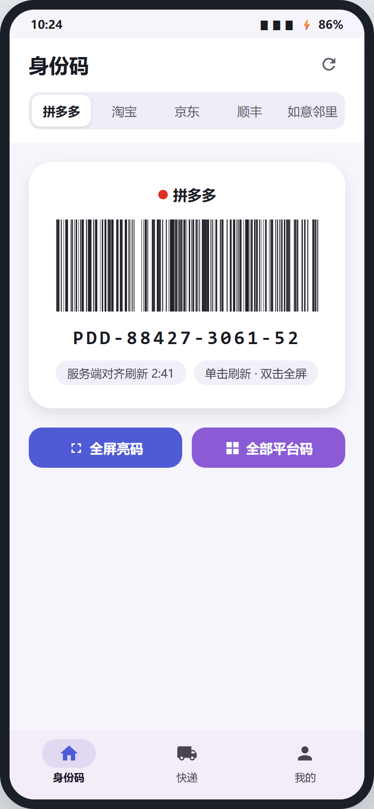
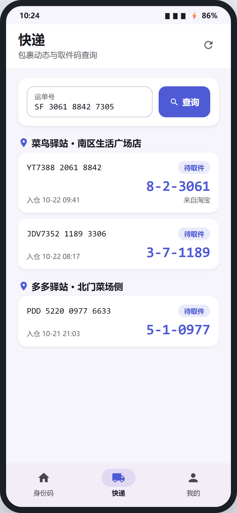
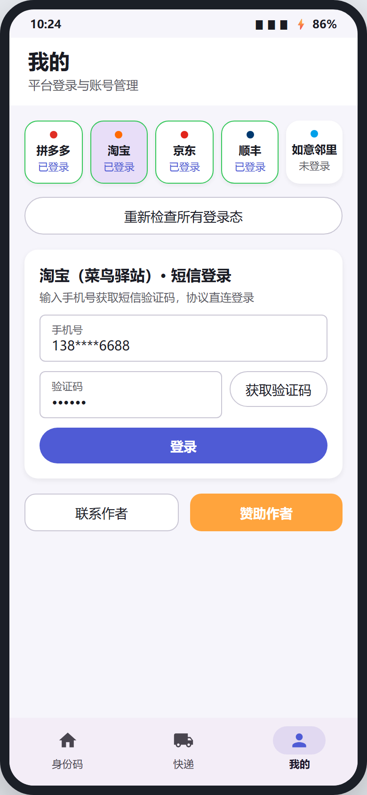

# 码上取

> 多平台身份码聚合 App——把拼多多、淘宝、京东、顺丰、如意邻里的取件身份码和快递信息装进一个应用，一站式出示、快速切换。

无后端、纯本地运行的 Android 应用：登录态保存在本机加密存储，所有请求由 App 直连平台接口，数据不上传任何服务器。

<p>
  
  
  
</p>

## 功能特性

- **五平台身份码聚合**：拼多多 / 淘宝菜鸟 / 京东 / 顺丰 / 如意邻里，大幅二维码/条码展示，下拉刷新 + 可配置自动刷新；顺丰身份码本地公式生成，长期免调用
- **快递列表聚合**：各平台站点快递统一展示，按平台/站点筛选，跨平台按运单号去重合并、互补查码；本地缓存支持离线查看
- **取件码详情**：单件快递取件码大字/大图展示，方便驿站出示
- **登录态管理**：启动自动检查各平台登录态有效性，失效标红并支持一键重登
- **应用内更新**：启动自动检查新版本，应用内下载 APK 并拉起安装（版本源为仓库 `update/latest.json`，经 jsDelivr CDN 读取，客户端零密钥）
- **运行日志**：「我的」页实时日志面板，一键复制排查

## 登录方式

| 平台 | 登录方式 |
|---|---|
| 淘宝 | 手机号 + 短信验证码（App 内协议登录） |
| 京东 / 顺丰 / 拼多多 | 微信 code 换链（经远程 YYB-GO 服务签发，App 直连平台完成换链） |
| 如意邻里（圆通） | 手机号 + 图形验证码 + 短信验证码（App 内完成） |

## 下载安装

前往 [Releases](https://github.com/njpemo/mashangqu/releases) 下载最新 APK 安装即可，或直接安装最新版：

- [mashangqu-v1.0.6.apk](https://github.com/njpemo/mashangqu/releases/download/v1.0.6/mashangqu-v1.0.6.apk)

安装后新版本可通过 App 内更新自动获取（也可随时回 Releases 下载）。

## 构建环境

- Android Studio / Kotlin 2.x + Jetpack Compose
- minSdk 26 / targetSdk 34

```bash
cd app
.\gradlew.bat assembleDebug
```

产物位于 `app/app/build/outputs/apk/`。

## 发版流程

更新源为主：`https://msq.12.ink/api/check.php`（虚拟主机 PHP 代理，服务端持有蒲公英 Key，见 `server/check.php`），兜底为 jsDelivr / GitHub raw 静态源 `update/latest.json`。

1. 修改 `update/latest.json`（versionCode/versionName），`.\gradlew.bat assembleRelease`；
2. APK 上传蒲公英即完成发版——check.php 自动返回最新包信息（versionCode 取包上传时间，无需手动维护）；
3. 可选：把下载直链同步进 `latest.json` 推送，作为兜底源。

## 项目结构

```
app/
├── app/                宿主壳：三个页面（身份码 / 快递 / 我的）、导航、应用内更新
├── core/
│   ├── model/          统一数据模型与错误模型
│   ├── network/        OkHttp/Retrofit 基础配置
│   ├── storage/        Keystore 加密存储、Room 缓存、DataStore 设置
│   ├── webview/        通用登录 WebView 组件
│   └── yyb/            YYB-GO 远程服务 HTTP 客户端
└── platform/
    ├── api/            PlatformAdapter 接口契约
    ├── pdd/ taobao/ jd/ sf/ ryll/   各平台适配器实现
```

## 免责声明

本项目**仅供个人学习与自用**，不分发、不商用。凭据仅存储于本机（Keystore + EncryptedSharedPreferences 加密），永不上传。使用本项目产生的一切账号风险由使用者自行承担，请遵守各平台用户协议。

---

*文档版本：v1.5 ｜ 2026-10-22*
