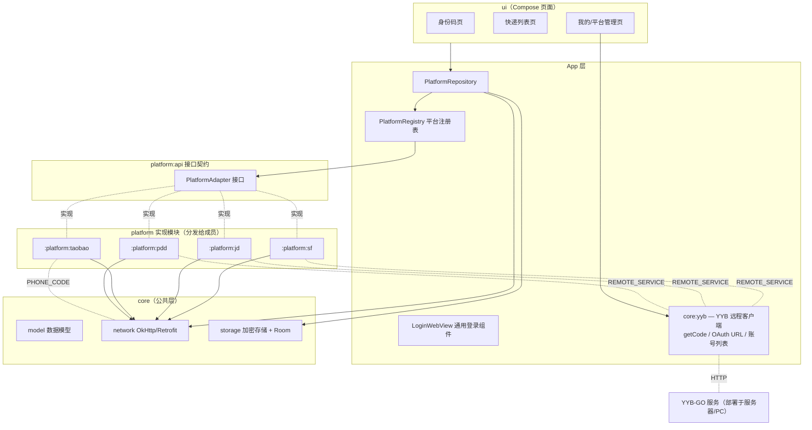
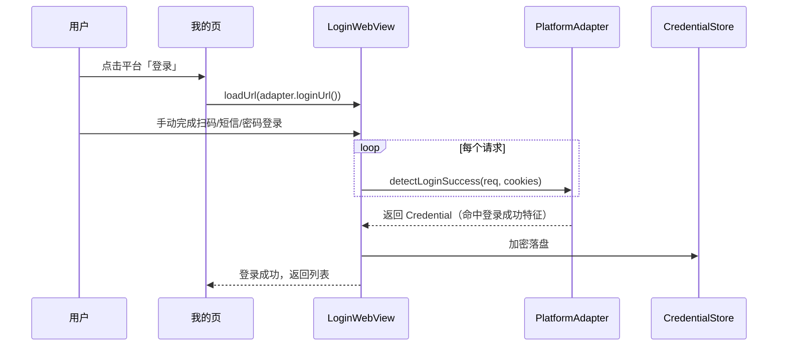

# 身份码聚合 App — 总体规划文档

> 无后端、纯本地运行的 Android 应用。聚合拼多多 / 淘宝 / 京东 / 顺丰四平台的「身份码」与快递取件信息，一站式展示。

---

## 1. 项目简介

### 1.1 背景与目标

取件人在驿站/快递站需要出示各平台的「身份码」（拼多多、淘宝菜鸟、京东、顺丰各自独立），且取件码分散在各自 App 中，来回切换非常麻烦。

本项目做一个 **Android 本地应用**：

- 淘宝在 App 内输入手机号+短信验证码完成**协议登录**，京东/顺丰/拼多多统一由 **部署的 YYB-GO 服务** 提供微信 code 签发（App 内远程调用，服务地址可在「我的」页配置，见第 3.4 节）；
- 使用本地保存的登录态直接调用各平台接口，**获取身份码**并本地渲染二维码/条码；
- **聚合各平台站点的快递列表与取件码**，统一展示；
- **不依赖任何自建后端**，所有请求由 App 直连平台接口，数据仅存本地。

### 1.2 核心功能清单

| 模块 | 功能 | 说明 |
|---|---|---|
| 平台登录 | 短信验证码登录（淘宝，App 内输入手机号）+ 远程 YYB-GO 服务签发微信 code（京东/顺丰/拼多多） | 全部为协议登录，无 WebView 登录页；App 启动时自动检查所有登录态有效性 |
| 身份码 | 四平台身份码展示 | 拉取码内容 → 本地渲染二维码/条码，下拉刷新 + 可配置自动刷新；**顺丰已破解**：伪动态，`{Unix秒−1640010000}{ACS}{用户静态段}` 本地公式生成 + 3 分钟校准（见 sf.md §4.3），长期免调用 |
| 快递列表 | 各平台站点快递聚合展示 | 按平台/站点筛选，含取件码、到件时间、状态；本地缓存支持离线查看 |
| 取件码 | 单件快递取件码查询/大图展示 | 列表卡片点开查看详情 |
| 登录态管理 | 各平台登录状态检查、重登入口 | 失效自动标记「需重新登录」 |

### 1.3 明确不做的事（YAGNI）

- ❌ 不做自动化账密登录（密码/滑块风控不可控；**短信验证码登录是例外**——淘宝短信链路无滑块已实测可自动化，且验证码由用户本人收取输入）
- ❌ 不做多账号支持（每平台单账号，失效重登覆盖；架构预留扩展）
- ❌ 不做数据后端（数据面全部由 App 直连平台接口）；微信 code 签发由 **部署的 YYB-GO 服务** 完成（服务仅承担登录面，数据面仍直连平台），见第 3.4 节
- ❌ 不做 iOS / 桌面端

---

## 2. 技术选型

| 项 | 选择 | 理由 |
|---|---|---|
| 平台 | Android only | APK 直接分发团队内部使用，无上架审核 |
| 语言/UI | Kotlin 2.x + Jetpack Compose | 声明式 UI 开发效率高，官方主推 |
| 最低支持 | minSdk 26 / targetSdk 34 | 覆盖主流设备 |
| 依赖注入 | Hilt | 模块化注入平台适配器 |
| 网络 | OkHttp + Retrofit + kotlinx.serialization | 请求直连平台接口，序列化可控 |
| 微信登录协议层 | **远程 YYB-GO 服务**（部署在服务器/PC，App 经 HTTP 调用） | 内嵌 gomobile aar 已验证不可行（真机 ShortLink 0-RTT `AppData decrypt/parse failed`，新账号也复现，见 §3.4 决策记录）；远程服务复用现网验证过的 YYB 实现，code 签发稳定，账号扫码在服务端 Web 页完成 |
| WebView 拦截 | WebViewClient.shouldInterceptRequest + CookieManager + JS 注入 | 登录态抓取核心 |
| 存储 | Android Keystore + EncryptedSharedPreferences（凭据）、Room（快递缓存）、DataStore（设置） | 凭据加密落盘，永不外传 |
| 码渲染 | ZXing core | 身份码/取件码二维码与条码本地渲染 |

---

## 3. 总体架构

### 3.1 架构总览



**要点：**

- `platform:api` 定义唯一接口契约，4 个平台模块各自实现，**互不可见、互不依赖**；
- `:app` 通过 Hilt 收集所有 `PlatformAdapter` 实现注册进 `PlatformRegistry`；
- 各平台模块只依赖 `platform:api` 与 `core`，内部自由处理签名、UA、解析；
- 平台接口变更只需改对应平台模块，契约不变。

**YYB 微信登录面（core:yyb）**：App 不再内嵌 YYB 协议库。微信 code 签发由**部署的 YYB-GO 服务**完成（源码：`D:\身份码聚合app\YYB-Go-Enhanced-main`，运行即自带 Web 管理页），App 侧 `core:yyb` 是它的 HTTP 客户端（OkHttp），接口契约见 §3.4。微信账号的扫码添加、凭据保活、会话维护**全部在服务端完成**，App 只负责：配置服务地址、拉取账号列表、按平台 appid 取 code。

> **决策记录（2026-09-27，v1.3）**：放弃 gomobile 内嵌 `yyblib.aar` 方案（设计文档 `porting/移植设计文档.md` 已归档废弃）。原因：真机实测 `GetCode` 稳定失败——`all ShortLink targets failed; last error: AppData decrypt/parse failed`，即 mmtls 0-RTT 握手后 AppData 用本地 PSK 派生密钥无法解密；**新扫码账号凭据全新也复现**，排除会话过期，属协议/环境层问题（真机 VPN/网络中间盒干扰或协议密钥派生失配），短期内无法修复。远程部署的 YYB-GO 服务在 PC/服务器网络环境运行无此问题，且服务端 Web 页天然解决「同设备无法扫码」的死结（手机扫 PC 屏幕上的码）。内嵌 aar 产物保留在 `app/core/yyb/libs/` 供回退参考。

> **保活策略（v1.3 起）**：微信凭据保活**全部交给 YYB-GO 服务端**（服务自带 refresh 机制，约 25 天提示重扫一次，在服务端 Web 页 `/scan` 完成扫码）。App 侧零保活任务：京东 pt_key 约 1 年、拼多多 accesstoken 约 30 天、淘宝以 `checkAlive` 探测为准、顺丰身份码静态段永久——各平台登录态都握在 App 本地，仅失效时才需要经 YYB 服务重走换链。

### 3.4 YYB-GO 远程服务契约（core:yyb ←→ 服务）

> 端点以 YYB-GO-Enhanced 源码 `internal/httpapi/app.go` 注册表为准；`/wxapp/*` 与 `/wx/*` 为免登录的自动化路由（浏览器会话之外的客户端调用通道）。

| 能力 | 端点 | 说明 |
|---|---|---|
| 健康检查 | `GET /health` | 启动检查服务可达性 |
| 取小程序 code | `POST /wxapp/getCode` | body `{"ref": "openid或数字id(必填)", "app_id": "目标小程序appid"}`；409=login_buffer 过期需重扫；返回 `{openid, account:{...}, result:{code, errMsg}}`——京东/顺丰的 wx.login code 源 |
| 构造网页 OAuth URL | `POST /wx/oauth` | body `{ref(必填), appid, redirect_uri, scope?, state?}`；返回 `{url, full_url, mode:"authorization_url"}`——拼多多 accesstoken 换链用 |
| 账号列表 | 管理页/接口 | 「我的」页展示服务端已添加的微信账号（openid/昵称/状态） |
| 手动续期 | `POST /accounts/refresh` | 服务端 Web 页操作；App 不负责保活 |
| 扫码添加账号 | 服务端 Web 页 `/scan` | **在 PC/服务器上出码，手机微信扫 PC 屏幕**——同设备无法扫码的官方解法 |

App 侧要求：

- 「我的」页新增 **YYB 服务卡片**：BASE URL + 访问凭据（若服务开启用户体系则存 token）配置，Keystore 加密落盘；
- 取 code 前先 `GET /health` 探活，失败提示「YYB 服务不可达，请检查配置或网络」；
- 超时（连接 5s / 读 30s）、失败重试 1 次、错误归一为 `PlatformError.NetworkError`；
- 服务地址变更只改配置，不重启生效。

### 3.2 模块结构

```
:app                宿主壳：导航、三个页面、Hilt 装配
:core:model         统一数据模型与错误模型（全项目唯一模型来源）
:core:network       OkHttp/Retrofit 基础配置（通用 UA、日志开关、超时）
:core:storage       CredentialStore（Keystore 加密）、ExpressCache（Room）、SettingsStore（DataStore）
:core:webview       LoginWebView 通用组件：请求拦截 + Cookie 捕获 + JS 注入钩子
:core:yyb           YYB-GO 远程服务 HTTP 客户端：getCode / OAuth URL / 账号列表 / 服务配置（契约见 §3.4）
:platform:api       PlatformAdapter 接口、CapturedRequest、平台注册机制
:platform:pdd       拼多多实现  ← 分发任务 1
:platform:taobao    淘宝实现    ← 分发任务 2
:platform:jd        京东实现    ← 分发任务 3
:platform:sf        顺丰实现    ← 分发任务 4
```

### 3.3 代码目录规划

```
身份码聚合app/
├── README.md                    ← 本文档
├── docs/
│   ├── platform/                ← 各平台开发文档（分发用）
│   │   ├── taobao.md            ← 淘宝（陈柯涵）
│   │   ├── jd/                  ← 京东独立文件夹（jd/jd.md）
│   │   ├── sf/                  ← 顺丰独立文件夹（sf/sf.md）
│   │   └── pdd.md               ← 拼多多（待分发）
│   └── capture/                 ← 各平台抓包样本 JSON（脱敏后归档，供单测使用）
├── app/
├── core/
│   ├── model/  network/  storage/  webview/
└── platform/
    ├── api/  pdd/  taobao/  jd/  sf/
```

---

## 4. 核心契约（platform-api）

> ⚠️ 此节是**分发给平台开发成员的统一契约**，接口签名与数据模型字段名不得擅自修改；确需变更时先在群里同步并更新本文档。

### 4.1 平台适配器接口

```kotlin
interface PlatformAdapter {
    val platform: Platform

    /**
     * 登录方式：
     * - REMOTE_SERVICE：京东/顺丰/拼多多——内嵌 YYB-GO 库扫码登录微信 → GetCode → code 换平台登录态
     * - PHONE_CODE：淘宝——App 内输入手机号+短信验证码，协议直调（sendSms.do → sms/login.do）
     * - WEBVIEW：兜底保留（当前无平台使用，平台链路失效时的应急通道）
     */
    val loginMode: LoginMode get() = LoginMode.REMOTE_SERVICE

    /** loginMode == REMOTE_SERVICE 时生效：调用内嵌 YYB-GO 库（core:yyb）获取/刷新凭据 */
    suspend fun remoteLogin(): Credential? = null

    /** loginMode == PHONE_CODE 时生效：发送短信验证码 */
    suspend fun sendSmsCode(phone: String)

    /** loginMode == PHONE_CODE 时生效：验证码 + 手机号协议登录 */
    suspend fun loginWithSmsCode(phone: String, smsCode: String): Credential

    /** WEBVIEW 登录时加载的登录页地址；REMOTE_SERVICE 时可不实现 */
    fun loginUrl(): String

    /**
     * WebView 请求拦截回调。
     * LoginWebView 会在每个请求上回调本方法，平台实现自行判定"登录成功"
     * （依据 URL 特征、Cookie、响应内容），命中后返回提取好的凭据，否则返回 null。
     */
    fun detectLoginSuccess(req: CapturedRequest, cookies: Map<String, String>): Credential?

    /** 登录态有效性检查（轻量接口调用），true = 仍有效 */
    suspend fun checkAlive(cred: Credential): Boolean

    /** 获取身份码内容（App 负责渲染） */
    suspend fun fetchIdentityCode(cred: Credential): IdentityCode

    /** 快递列表（按页） */
    suspend fun fetchExpressList(cred: Credential, page: Int): List<ExpressItem>

    /** 单件快递取件码查询；查不到返回 null */
    suspend fun fetchPickupCode(cred: Credential, expressId: String): PickupCode?
}

enum class LoginMode { REMOTE_SERVICE, PHONE_CODE, WEBVIEW }
```

### 4.2 WebView 捕获上下文

```kotlin
data class CapturedRequest(
    val url: String,
    val method: String,
    val headers: Map<String, String>,
    // 注意：Android WebView 拦截层拿不到 POST body；
    // 如需响应体/请求体，平台模块通过 core:webview 提供的 JS 注入钩子自行 hook fetch/XHR。
)
```

### 4.3 统一数据模型（:core:model）

```kotlin
enum class Platform(val label: String) {
    PDD("拼多多"), TAOBAO("淘宝"), JD("京东"), SF("顺丰")
}

/** 平台登录凭据（落盘前由 CredentialStore 加密） */
data class Credential(
    val platform: Platform,
    val token: String,                            // Cookie 串或 Token 主体
    val extra: Map<String, String> = emptyMap(),  // 辅助字段：userId、设备号、h5_tk 等
    val capturedAt: Long,
)

/** 身份码 */
data class IdentityCode(
    val platform: Platform,
    val type: CodeType,          // QR / BARCODE / IMAGE_URL
    val content: String,         // 码内容；IMAGE_URL 时为图片地址
    val expireAt: Long? = null,  // 有效期，可空
)

enum class CodeType { QR, BARCODE, IMAGE_URL }

/** 快递条目（列表卡片数据源） */
data class ExpressItem(
    val id: String,              // 平台内唯一 ID（fetchPickupCode 入参）
    val platform: Platform,
    val station: String,         // 站点/驿站名
    val stationAddress: String? = null,
    val trackingNo: String? = null,
    val pickupCode: String? = null,   // 列表直接携带的取件码，可空
    val summary: String? = null,      // 物品/商家描述
    val status: ExpressStatus = ExpressStatus.WAIT_PICKUP,
    val arrivedAt: Long? = null,
    val fetchDeadline: Long? = null,  // 最迟取件时间
    val raw: String? = null,          // 原始 JSON，仅调试用，UI 不读
)

enum class ExpressStatus { WAIT_PICKUP, PICKED, TIMEOUT, UNKNOWN }

/** 取件码详情 */
data class PickupCode(
    val expressId: String,
    val platform: Platform,
    val code: String,
    val qrContent: String? = null,   // 若支持扫码取件
)

/** 平台登录态（「我的」页数据源） */
data class PlatformLoginState(
    val platform: Platform,
    val loggedIn: Boolean,
    val needRelogin: Boolean = false,
    val lastCheckAt: Long? = null,
)
```

### 4.4 统一错误模型

平台模块内所有异常 **必须** 归一为以下类型后抛出，UI 层统一处理：

```kotlin
sealed class PlatformError(message: String) : Exception(message) {
    class NeedRelogin(val platform: Platform) : PlatformError("登录态失效")   // → UI 标记需重登
    class SignFailed(val platform: Platform, val detail: String) : PlatformError("签名失败")
    class RateLimited(val platform: Platform) : PlatformError("请求过于频繁")
    class ParseFailed(val platform: Platform, val detail: String) : PlatformError("解析失败")
    class NetworkError(val platform: Platform, val cause: Throwable) : PlatformError("网络错误")
}
```

处理规则：

| 错误 | UI 行为 | 数据行为 |
|---|---|---|
| NeedRelogin | 平台卡片标红「需重新登录」+ 一键重登按钮 | 清除本地缓存中该平台的身份码/列表 |
| RateLimited | Toast 提示，本次刷新跳过该平台 | 保留旧缓存 |
| SignFailed / ParseFailed | Toast「该平台接口异常，等待适配更新」 | 保留旧缓存 |
| NetworkError | 离线横幅，展示缓存数据 | 保留旧缓存 |

### 4.5 注册机制

每个平台模块提供一个 `@Module @InstallIn(SingletonComponent::class)` 的 Hilt Module，`@IntoMap` 绑定 `Platform -> PlatformAdapter`；`:app` 注入 `Map<Platform, PlatformAdapter>` 构建 `PlatformRegistry`。新平台接入只需新增模块，`:app` 不改代码。

---

## 5. 关键流程

### 5.1 登录态抓取流程



- 登录成功判定特征（URL 特征 / 关键 Cookie 名 / 关键响应）**由各平台模块自行定义**，写进对应平台文档；
- 判定必须幂等可重复触发（重复命中不重复落盘）；
- 严禁在日志中输出凭据明文；
- **REMOTE_SERVICE 模式（京东/顺丰/拼多多，远程 YYB-GO 服务）**：不做 WebView 登录，`loginUrl()/detectLoginSuccess()` 空实现。「我的」页登录流程：

```
前置（一次性）：YYB-GO 服务部署并运行 → 服务端 Web 页 /scan 出码 → 手机微信扫 PC 屏幕扫码确认
  → 服务端完成 code→credentials→login_buffer 入库（App 侧零扫码逻辑）

平台换链（App 内点按钮）：
  adapter.remoteLogin() → core:yyb 调服务端 POST /wxapp/getCode {appid: 平台小程序 appid}
  → 拿到 wx code → 平台模块用 code 走各自的「code 换登录态」链路（App 直连平台接口）：
      京东：v2/login（code+encryptedData/iv）→ wxapp_gentoken → wxapp_appjmp → pt_key/pt_pin
            （pt_key 实测有效期约 1 年，登录一次长期可用）
      顺丰：POST /e-mini/mini/login {code} → YJY-Auth JWT（~24h）
      拼多多：core:yyb 调服务端 POST /wx/oauth {appid, redirect_uri} 构造 OAuth 链接
            → App 请求该链接 → 302 换 accesstoken（约30天）
  → Credential 加密落盘
```

- code 签发在 YYB-GO 服务端完成；**数据面（换链、身份码、快递）仍由 App 直连平台接口**，服务端不碰平台数据；
- 服务不可达时：已落盘的各平台登录态不受影响（照常出码），仅「重走换链」不可用，UI 提示检查 §3.4 配置。

- **PHONE_CODE 模式（淘宝）**：App 内输入手机号 → `sendSmsCode()` 调 `POST /havanaone/loginLegacy/sms/sendSms.do` 拿 smsToken → 用户回填验证码 → `loginWithSmsCode()` 调 `sms/login.do`（ua/umidToken 传空串即可，无滑块）→ Set-Cookie 全套（含 httpOnly cookie2/unb/skt）→ 加密落盘。链路细节见 `docs/platform/taobao.md`。

### 5.2 身份码 / 快递数据流

```
进入身份码页 → Registry 取各平台 adapter → 已登录? checkAlive
  ├─ 有效 → fetchIdentityCode → 本地渲染 QR/条码 → 缓存
  └─ 失效 → 标记 needRelogin，展示重登入口
进入快递页 → 并发调用各平台 fetchExpressList(page)（各自独立容错）
          → ① 只保留待取件，跨平台按运单号去重
          │     （同一单多平台各有一份 → 合并一条：有码优先、站点/地址/描述互补、入仓取更早）
          → ② 无码待取件 → 用运单号依次调其他平台 fetchPickupCode 互补查码
          │     （上次命中渠道优先，否则 淘宝→拼多多→如意邻里→顺丰；
          │       查到 → 填码并记录来源渠道持久化，下次优先；查不到 → 原样展示）
          → ③ 按驿站分组展示；互补查到码的卡片标注「来自XX」渠道
跟踪单号 → 搜索查到的单持久化跟踪，每次刷新按来源平台复查状态，签收/查无自动移除
```

**刷新策略**：手动下拉刷新 + 可配置自动刷新（DataStore 设置项，默认关闭）；刷新按平台独立并发，单平台失败不影响其他平台展示。

### 5.3 启动登录态检查（每次打开 App 必跑）

```
App 启动（前台）→ LoginStateChecker 并发执行：
  ① YYB 服务可达性：GET {YYB_BASE}/health（失败仅提示，不阻塞）
  ② 淘宝：checkAlive(cred)（轻量接口，如 com.cainiao.pickup.user.get）
  ③ 京东/顺丰/拼多多：checkAlive(cred)（各平台轻量接口）
  → 结果写入 PlatformLoginState（含 lastCheckAt），「我的」页与身份码页据此渲染
  → 某 YYB 平台失效且需要重走换链时：core:yyb 经远程服务 getCode/OAuth 重换
     └─ 服务不可达 → 卡片提示「YYB 服务不可达」，其余平台照常
```

- 检查全程并发、单平台超时不阻塞其他平台（整体 5s 超时兜底）；
- 离线/网络错误时保留上次检查结果，UI 显示「上次检查时间」；
- 不做后台周期检查——App 不在前台就不产生任何请求；微信凭据保活由 YYB 服务端自理。

---

## 6. 页面设计（Compose，底部三 Tab）

| Tab | 内容 |
|---|---|
| **身份码** | 顶部平台 Tab（4 个）→ 大幅二维码/条码 + 有效期倒计时 + 手动刷新按钮；未登录/失效时显示对应平台登录引导 |
| **快递** | 顶部筛选（平台多选 + 站点下拉）→ 快递卡片列表（站点、取件码大字、单号、状态、到件时间、最迟取件）；下拉刷新；点击卡片进取件码详情（大图/大字，方便出示） |
| **我的** | 微信账号卡片（京东/顺丰/拼多多共用，见 6.1）→ 淘宝登录卡片（见 6.2）→ 设置（自动刷新开关与间隔）→ 清除全部数据 → 免责声明 |

UI 状态统一为：`Loading / Content / Empty / Error(PlatformError)`，Empty 态区分「未登录」与「无数据」。

### 6.1 YYB 服务卡片（京东/顺丰/拼多多共用）

三个平台都依赖远程 YYB-GO 服务取 code，所以收进「服务配置 + 账号状态 + 平台换链」一张卡片：

```
┌─────────────────────────────────────┐
│ ⚙ YYB 服务                 [已连接] │
│ https://yyb.example.com             │
│ 微信账号：张三*（服务端在线）        │
│ ┌─────────┬─────────┬─────────┐     │
│ │ 京东 ✓  │ 顺丰 ✓  │ 拼多多 ✗ │    │
│ │ ~1年有效 │ 静态生成 │ 30天有效 │    │
│ └─────────┴─────────┴─────────┘     │
│ [获取京东登录态] [获取顺丰] [获取拼多多]│
└─────────────────────────────────────┘
```

- **首次使用**：卡片显示配置表单（BASE URL + 访问凭据），保存后 `GET /health` 探活，连通显示 [已连接]；
- **添加微信账号**：卡片内引导「在 YYB 服务端 Web 页 /scan 扫码」（服务端出码 → 手机扫 PC 屏幕），App 不再有扫码弹层；
- **平台换链**：点对应按钮 → `POST /wxapp/getCode`（京东/顺丰）或 `POST /wx/oauth`（拼多多）→ App 直连平台完成换链 → 凭据加密落盘 → 子格变绿；
- 子平台单项失效时单独点该按钮重换；服务不可达时按钮置灰并提示检查配置；
- 微信凭据保活在服务端完成（服务自带 refresh，约 25 天在服务端 Web 页重扫一次），App 无保活逻辑。

### 6.2 淘宝登录卡片（短信验证码，App 内完成）

```
┌─────────────────────────────────────┐
│ � 淘宝                  [未登录]    │
│ [手机号登录]                         │
└─────────────────────────────────────┘
点击 → 短信登录底部弹层：
  1. 输入手机号 → [获取验证码]（sendSmsCode，60s 重发倒计时）
  2. 回填 6 位验证码 → [登录]（loginWithSmsCode）
  3. 成功 → 卡片变绿 [已登录]，Cookie 全套加密落盘
失效时卡片标红「需重新登录」，点击重走同一弹层（无需 WebView）
```

> 备用入口：协议链路被风控时，卡片提供「网页登录」fallback（LoginWebView 兜底，即 §4.1 的 WEBVIEW 模式）。

---

## 7. 平台模块开发规范（给分发成员）

### 7.1 模块边界

- ✅ 可以做：模块内新建任意类/文件、定义平台私有常量、自建签名工具、自建解析器
- ❌ 不可以做：修改 `platform:api`、`core:*` 的接口与模型字段；跨模块引用其他平台模块；把平台专属类型泄漏到契约之外

### 7.2 每个平台模块必须交付

| 交付物 | 要求 |
|---|---|
| `XxxAdapter` 实现 | 完整实现 4.1 全部方法 |
| 登录成功判定器 | 定义 URL/Cookie/响应特征，幂等 |
| 签名器 | 平台接口所需签名/加密，含单元测试 |
| 解析器 | 接口响应 → 统一模型，含单元测试 |
| 异常归一 | 所有失败路径归一为 4.4 的 `PlatformError` |
| Mock 数据 | 真实抓包 JSON（**脱敏**）归档到 `docs/capture/<platform>/` |
| 平台文档 | 按 `docs/platform/template.md` 模板完成，含接口明细 |

### 7.3 测试与验收标准

- 解析器、签名器必须有单测（MockWebServer + 归档 JSON 驱动）；
- 手动验收清单（缺一不可）：
  - [ ] 各模式登录后 **10 秒内** 凭据落盘（PHONE_CODE：验证码提交后；REMOTE_SERVICE：扫码确认+换链完成）
  - [ ] 冷启动触发 §5.3 登录态检查，失效平台正确标红
  - [ ] 杀进程重开，登录态仍在且 `checkAlive` 通过
  - [ ] 身份码展示、刷新正常
  - [ ] 快递列表分页 + 下拉刷新正常，字段与真实 App 一致
  - [ ] 取件码查询/详情展示正常
  - [ ] 篡改本地凭据后，所有接口正确返回 `NeedRelogin` 且 UI 标红
  - [ ] 单测全部通过，Mock JSON 已归档

### 7.4 工程约定

- 分支：`platform/<name>` 开发，PR 合入 `main`，PR 必须带验收截图与单测结果；
- 命名：平台前缀（如 `JdAdapter`、`PddSigner`、`SfUrlParser`）；
- 禁止：硬编码个人账号/真实凭据进仓库；日志打印 Cookie/Token；提交未脱敏抓包文件。

---

## 8. 任务分发计划

> 主线（负责人）先完成 **M0 骨架**，之后四个平台任务并行分发。

| 阶段 | 任务 | 依赖 | 状态 |
|---|---|---|---|
| M0 | 项目骨架：多模块搭建、契约接口与模型、LoginWebView、页面框架、Mock 平台示例 | — | 主线负责 |
| M0b | **YYB-GO 服务部署与远程客户端**：部署 YYB-GO 服务（源码 `YYB-Go-Enhanced-main`）、服务端 `/scan` 扫码加账号、`:core:yyb` HTTP 客户端（§3.4 契约）、「我的」页 YYB 服务卡片、**code 等价性实测**（京东/顺丰/拼多多换链全流程验证） | — | 主线负责 |
| M1 | 拼多多模块（YYB code 换 accesstoken / 身份码 / 快递 / 取件码） | M0, M0b | 待分发（pdd.md 待按同一模板生成） |
| M2 | 淘宝模块（**短信验证码协议登录** / 身份码 / 快递 / 取件码）→ 陈柯涵 | M0 | 已分发（docs/platform/taobao.md） |
| M3 | 京东模块（微信小程序 + 远程 YYB 服务登录路线；pt_key 实测约 1 年有效） | M0, M0b | 已分发（docs/platform/jd/jd.md） |
| M4 | 顺丰模块（微信小程序 + 远程 YYB 服务登录路线；身份码**伪动态已破解**——`{Unix秒−1640010000}{ACS}{静态段}` 本地生成 + 3 分钟校准，见 sf.md §4.3） | M0, M0b | 已分发（docs/platform/sf/sf.md） |
| M5 | 联调验收、UI 打磨、异常场景回归 | M1–M4 | 主线负责 |

**每份平台开发文档（`docs/platform/<name>.md`）固定包含：**

1. 平台入口与登录流程（登录页 URL、登录方式、页面跳转特征）
2. 登录成功判定（关键 Cookie/URL/响应特征 + 提取凭据方法）
3. 登录态校验接口（checkAlive 用的轻量接口）
4. 身份码获取接口（URL、Method、Header、参数、签名算法、响应结构 → IdentityCode 映射）
5. 快递列表接口（同上 → ExpressItem 映射，含分页与站点维度）
6. 取件码查询接口（同上 → PickupCode 映射）
7. 签名/加密算法说明与参考实现
8. Mock 数据与抓包样本索引
9. 已知风控点与注意事项

> 已生成：`docs/platform/taobao.md`（淘宝/菜鸟驿站，含已验证页面地图与 MTOP 签名机制）、`docs/platform/jd/jd.md`、`docs/platform/sf/sf.md`（小程序 + YYB-GO 路线，京东/顺丰各自独立文件夹）。拼多多待指定后按同一模板生成。

---

## 9. 安全与合规

1. **仅供个人学习与自用**，不分发、不商用；使用本项目产生的一切账号风险（风控、限流、封禁）由使用者自行承担。
2. 凭据仅存储于本机（Android Keystore + EncryptedSharedPreferences 加密），不上传任何服务器；卸载 App 或「清除全部数据」即彻底删除。
3. 各平台接口随时可能变更或加强风控，模块失效属预期情况，需按平台文档更新适配。
4. 请遵守各平台用户协议；本项目不破解、不绕过登录验证，登录动作始终由用户本人在官方登录页完成。

---

## 10. 风险与对策

| 风险 | 影响 | 对策 |
|---|---|---|
| 平台接口变更/加签 | 模块失效 | 契约不变，仅改平台模块内部；文档记录签名算法便于修复 |
| 风控识别（非官方 UA/频率） | 限流或临时封号 | 请求频率限制 + 随机化间隔；UA 对齐官方 H5；用户自担风险声明 |
| WebView 拿不到 POST body | 登录判定/抓取受阻 | core:webview 提供 JS 注入钩子（hook fetch/XHR），平台模块按需启用 |
| 某平台无 H5 登录入口 | 无法内嵌登录 | 改用「扫码授权」或引导从手机浏览器 Copy Cookie 导入（备用方案，触发时再评估） |
| 身份码有时效 | 码过期无法用 | 展示倒计时 + 自动/手动刷新 |
| 小程序登录链路风控 | 微信账号风控/封禁 | 逆向调试一律用小号 + 专用设备；登录请求频率克制；YYB-GO 侧限制并发 |
| YYB-GO 服务不可达（关机/网络） | 京东/顺丰/拼多多无法重走换链 | 服务部署在常开机器；App 侧已落盘登录态不受影响照常出码；卡片明示「服务不可达」；恢复后一键重换 |
| YYB 服务公网暴露被扫 | 微信账号被他人调用 | 服务开启用户体系/强口令；或仅内网/VPN 访问；`/wxapp/*` 自动化路由暴露面在部署时评估收紧 |
| 淘宝短信协议登录被风控 | 无法 App 内登录 | fallback：卡片「网页登录」走 LoginWebView（WEBVIEW 模式兜底） |
| 顺丰静态段失效（用户/设备维度变化） | 本地公式缺静态段，码无法生成 | 静态段由 `credentialPerson` 接口获取并随凭据缓存；checkAlive 失效时重取 |
| 小程序接口签名/版本变更 | 京东/顺丰模块失效 | 签名器独立成类 + 单测，变更时仅改签名器；解包源码归档便于复查 |

---

*文档版本：v1.3 ｜ 2026-09-27（**放弃 gomobile 内嵌 yyblib.aar，改用部署的 YYB-GO 远程服务**：真机 GetCode 稳定报 ShortLink `AppData decrypt/parse failed` 且新账号复现，无法修复；微信账号扫码/保活全部移至服务端 Web 页，App 侧 core:yyb 改为 HTTP 客户端，新增 §3.4 服务契约与「我的」页 YYB 服务卡片；淘宝短信验证码登录保持不变）｜ 上一版 v1.2：内嵌 YYB-GO 方案（见 `porting/移植设计文档.md`，已归档废弃）*
